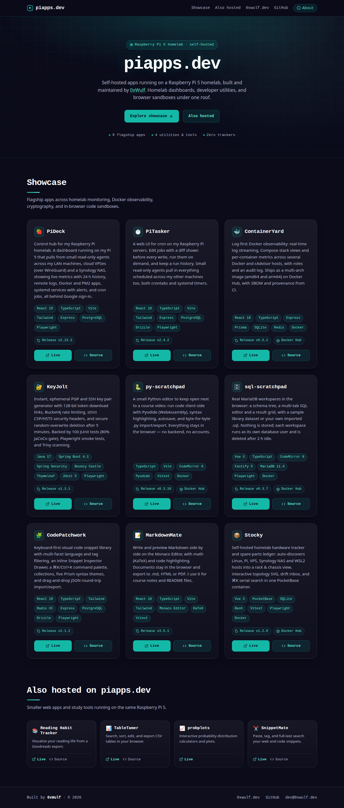
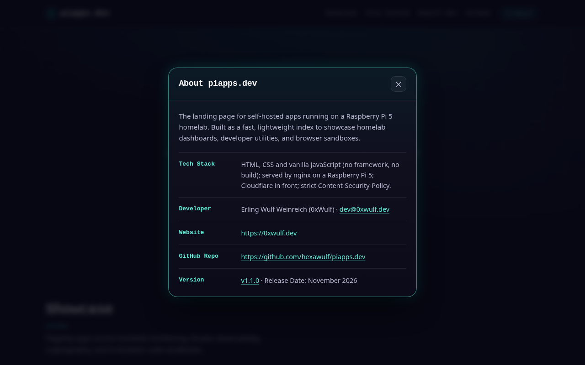
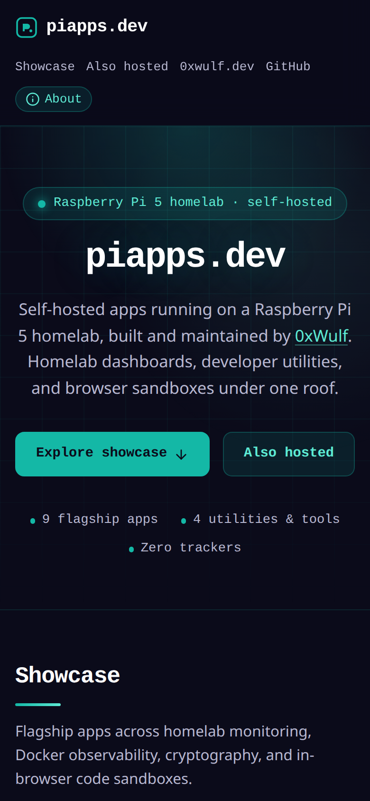

# piapps.dev

Static landing page for **[piapps.dev](https://piapps.dev)** — the umbrella domain for self-hosted apps built and operated by [0xWulf](https://0xwulf.dev) on a Raspberry Pi 5 homelab.

[](https://piapps.dev)
[](https://github.com/hexawulf/piapps.dev/actions/workflows/check.yml)
[](LICENSE)

## Screenshots

### Desktop



### About Modal & Mobile

| About modal (1280px) | Mobile (390px) |
| :---: | :---: |
|  |  |

## Highlights

- **Zero dependencies:** plain HTML5, CSS3, and ES modules — no frameworks, no build step, no external fonts or CDNs.
- **Accessible & responsive:** semantic landmarks, native `<dialog>` About modal, visible focus rings, `prefers-reduced-motion`, and clean layouts down to 360px.
- **Strict security headers:** Content-Security-Policy, `X-Content-Type-Options: nosniff`, and `Referrer-Policy` enforced by nginx.
- **Single source of truth:** showcase metadata in `src/data/projects.js` is synced with `hexawulf/0xwulf`.

## Stack

- Plain HTML5, CSS3, and vanilla JavaScript (ES modules)
- Served by nginx on a Raspberry Pi 5 behind Cloudflare
- Strict CSP (`default-src 'self'; img-src 'self' data:; style-src 'self'; script-src 'self' https://static.cloudflareinsights.com; connect-src 'self' https://cloudflareinsights.com`)

## Updating the cards

CSS and JS assets are cached for 7 days, so every change only reaches visitors when the referencing query string is bumped too:

1. Copy `src/data/projects.js` from `hexawulf/0xwulf` (keeping the top sync comment line).
2. Bump `?v=N` on the `./src/data/projects.js?v=N` import in `script.js` **and** on the `/script.js?v=N` tag in both `index.html` and `404.html` (and `/style.css?v=N` if CSS changed).
3. Commit (signed) and push to `main`.
4. Pull on `piapps` in the site deploy directory:

```bash
git pull --ff-only
```

## Deploy

nginx serves the repository checkout directly from the host's site folder. To deploy updates from `main`:

```bash
git pull --ff-only
```

## Local checks

```bash
npx --yes html-validate index.html 404.html
```

## License

MIT — see [LICENSE](LICENSE).
